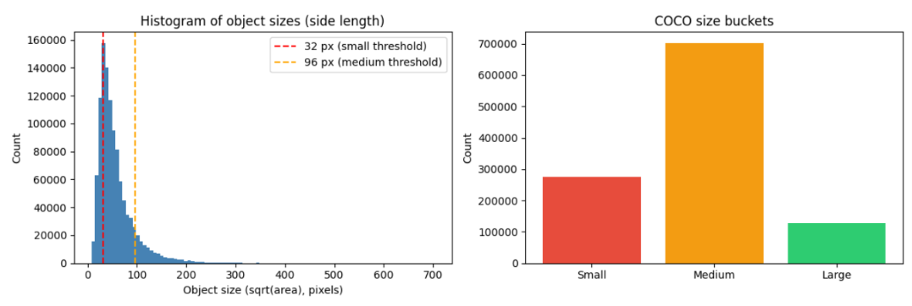
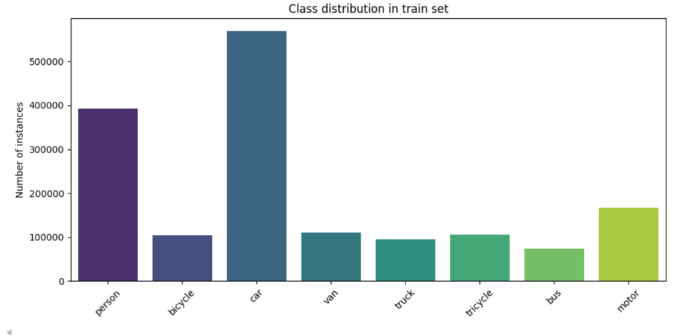
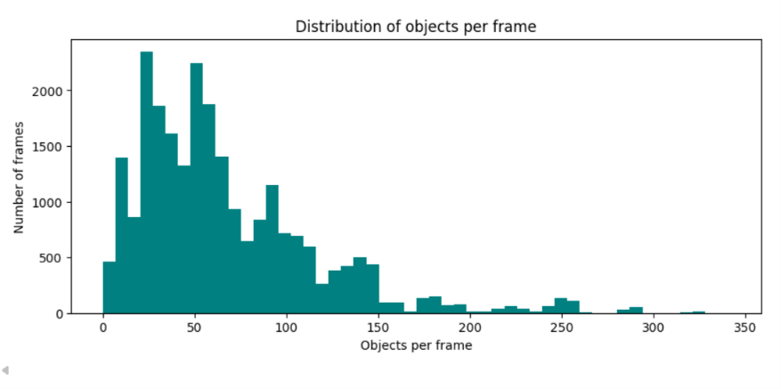
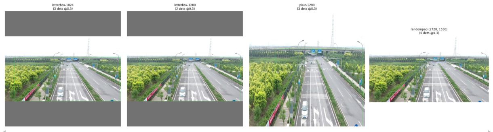
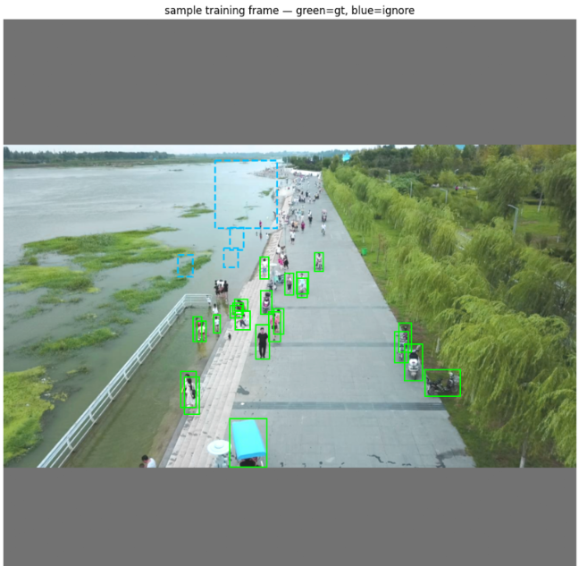
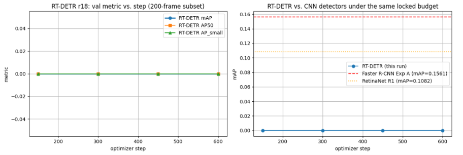
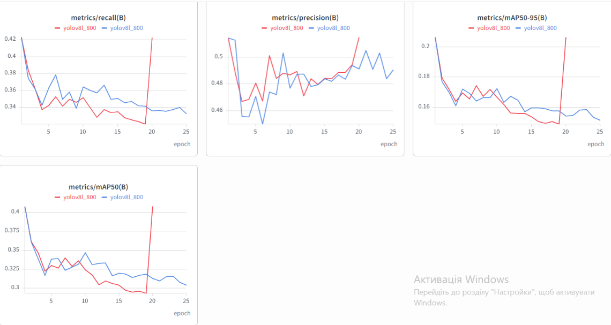

| Submission | Private LB | Public LB |
|---|---|---|
| submission_wbf_tta.csv (final) | **0.19932** | **0.26189** |
| submission_yolo.csv | 0.17211 | 0.23619 |
| fcosp-2 | 0.03012 | 0.03687 |
| RetinaNetR1 | 0.09071 | 0.09851 |
| baseline-5 (Faster R-CNN) | 0.14323 | 0.18888 |

---

## Summary

I detect 8 VisDrone classes in drone video using deep detectors. Data: 56 training clips (24,201 frames), 7 validation clips (2,846 frames), 3,811 hidden test frames. Metric: COCO mAP@[.5:.95]. Our best single model is **YOLOv8l epoch-1 at imgsz=800**, public LB **0.23619** (private 0.17211). Our final submission is **TTA + Weighted Boxes Fusion** on that checkpoint, public LB **0.26189** (private 0.19932). The largest gains over our best required-family model (Faster R-CNN, public 0.18888 / private 0.14323) came from inference strategy, not architecture. The public and private rankings agree, so the final choice is not a public-LB artefact. Several things that looked good on validation did not help on the leaderboard; we report these as they are.

## 1. Data Understanding and Preprocessing

The VisDrone2019-VID benchmark requires detecting 8 classes in unlabelled drone footage. The training set contains 24,201 frames (1.61M annotations) across 56 clips; validation contains 2,846 frames (146K annotations) across 7 clips. Resolutions vary from 1344×756 to 3840×2160.

**Class imbalance.** `car` (35.2%) and `person` (24.3%) dominate; the rarest classes are `bus` (4.5%) and `truck` (5.8%). This biases models toward majority classes and directly explains the van↔truck confusion in §2.3 and the collapse of `bus` to near-zero AP in every detector. It motivated Focal Loss in RetinaNet and class-aware failure analysis throughout.

**Object sizes.** Using COCO thresholds, 24.9% of objects are small (<32 px), 63.5% medium (32–96 px), 11.6% large (≥96 px). A 20×20 px pedestrian pooled to a 7×7 RoI becomes ~3×3 px of features. This informed the letterbox-1280 training resolution (§1.2), the k-means anchor configuration for RetinaNet (§3), and the inference-resolution experiments in §6.

**Scene density.** Frames average 66.8 objects (max 342). Dense scenes cause standard NMS to suppress true neighbours; this motivated Soft-NMS consideration and the WBF fusion in the final pipeline (§6.2). For query-based models, peak density sets a lower bound of ~300 queries.

**Clip variance.** Mean object side length ranges from 28 px to 156 px across sequences. Consecutive frames share >95% of instances, so we use a **clip-level split** (56 training clips, 7 validation clips) throughout — frame-level splitting would leak information and inflate validation.

**Anchor configuration (k-means).** Clustering GT widths/heights (k=9) produced anchors from 23.8×33.7 px to 336.4×221.7 px. These were converted to letterbox-1280 coordinates (11.2×15.9 to 158.6×104.5 in network space) and used to configure RetinaNet (§3), grounding the anchor set in the actual data rather than COCO defaults. Default COCO anchors reach IoU≥0.5 with only 75% of boxes; our k-means set reaches 98%.

### 1.2 Preprocessing ablation

Four resize strategies were compared with a zero-shot COCO-pretrained Faster R-CNN on a 200-frame subset, using mAP with `iscrowd=1` (ignore regions handled):

| Strategy | mAP |
|---|---|
| **letterbox-1280** | **0.0125** |
| letterbox-1024 | 0.0122 |
| randompad-(2720,1530) | 0.0116 |
| plain-1280 | 0.0083 |

`plain_resize` was ~34% worse: stretching a 3840×2160 aerial frame into a square distorts aspect ratios ~3×, destroying geometric features. `randompad` induced a distribution shift and downscaled large images before padding, losing small cues. Letterbox-1280 won and incurs no inference-speed penalty (0.197 vs 0.208 s/img). We also confirmed that evaluating with `iscrowd=0` rewards the wrong behaviour — strategies generating many boxes in crowds looked artificially good — so all subsequent evaluations use `iscrowd=1`, with detections inside crowd regions skipped.

**Annotation conversion and verification.** VisDrone annotations were converted to COCO format for evaluation and to YOLO format for the final pipeline. Non-target classes and ignored regions are encoded as `iscrowd=1`; detections inside them are not penalized. Conversion was verified by overlaying ground-truth boxes on sample frames before any training.

## 2. Two-stage Anchor-based: Faster R-CNN

### 2.1 Protocol

We fine-tuned `fasterrcnn_resnet50_fpn_v2` (COCO-pretrained, 9-class head, 43.3M params) with SGD (lr=5e-3, momentum=0.9), StepLR, batch size 2, letterbox-1280, and clip-level splits. One epoch at 1280² takes ~3.2 h on a T4, so the fixed budget was exactly 1 epoch. Ignore regions were masked by labelling anchors overlapping crowds (IoU>0.3) as `-1` via a custom `IgnoreAwareAssigner` wrapping the RPN matcher — without this, the model learns to treat pedestrians in crowds as background. A single-batch smoke test produced total loss 3.41, dropping to mean 0.6861 after one epoch.

### 2.2 Results and tuning

The baseline checkpoint was re-evaluated in a fresh session to establish a consistent reference (mAP 0.1373 → 0.1475; the Δ is session variability from CUDA/cuDNN non-determinism). Two parameters were changed one at a time, warm-started from the same checkpoint:

| Variant | Config | mAP | AP50 | AP75 | AP_small | AP_medium | AP_large | FPS |
|---|---|---|---|---|---|---|---|---|
| Baseline (recheck) | rpn=1000, pos=0.25 | 0.1475 | 0.3094 | 0.1267 | 0.0803 | 0.1570 | 0.2666 | 4.67 |
| **A — RPN ↑** | rpn=2000, pos=0.25 | **0.1561** | **0.3234** | **0.1335** | **0.0963** | **0.1656** | **0.2706** | 2.84 |
| B — RoI pos ↑ | rpn=1000, pos=0.50 | 0.1535 | 0.3197 | 0.1308 | 0.0952 | 0.1643 | 0.2654 | 2.86 |

**What the proposal stage contributes (Exp A).** Doubling `rpn_pre_nms_top_n_train` from 1000→2000 raised mAP by +0.0086 and — more importantly — raised AP_small by +0.0160 (+20% relative). At 1000 proposals a 31-px pedestrian competes poorly against large road/vegetation anchors and never reaches the RoI classifier; wider proposal retention lifts RPN recall on small objects so the second stage can classify them.

**What the second stage contributes (Exp B).** Doubling the RoI positive fraction raised mAP by only +0.0060 and left AP_small essentially unchanged. Per-class AP shows why: the extra positives mainly helped rare-class gradient signal, but the van↔truck confusion is **representational**, not sampling-driven — a 40×30 px van is pooled to ~5×4 px of features, too little signal to separate it from a truck regardless of sampling.

### 2.3 Per-class AP and failure cases

| Class | A (rpn=2000) | B (pos=0.5) |
|---|---|---|
| person | 0.2465 | 0.2440 |
| bicycle | 0.1117 | 0.1059 |
| car | 0.3368 | 0.3365 |
| van | 0.1703 | 0.1475 |
| truck | 0.1044 | 0.1078 |
| tricycle | 0.1757 | 0.1876 |
| bus | 0.0074 | 0.0055 |
| motor | 0.0961 | 0.0930 |

**Failure 1 — `bus` collapses to AP 0.0074.** Buses are 4.5% of the dataset and in aerial footage share the "large rectangular vehicle" signature with trucks and long vans. One epoch gives too few gradient steps to carve out the `bus` cluster.

**Failure 2 — Dense-scene duplicates.** Duplicate rate (predictions unmatched at IoU>0.5) is 0.524 for A, 0.580 for B. Two adjacent cars in a parking lot have mutual IoU ≈0.5 but only ≈0.4 with the shared GT box — standard NMS at IoU=0.5 deletes one. This directly motivates Soft-NMS/WBF in the final pipeline.

**Failure 3 — Small-object recall lags.** Even tuned A has AP_small 0.0963 vs AP_large 0.2706 (2.8× gap; down from 4.5× at baseline but not closed). RoI pooling to 7×7 destroys 20–30 px objects; higher input resolution or slicing at inference are the candidate fixes.

**Public LB: 0.18888 / Private: 0.14323** (Exp A, `score_thr=0.05, max_dets=500`, all 3,811 test frames non-empty).

## 3. One-stage Anchor-based: RetinaNet

Same locked protocol (letterbox-1280, SGD 5e-3, batch 2, 1 epoch, clip-level split, full-val COCO eval with `iscrowd=1`). torchvision's RetinaNet exposes no hook to mask ignore regions before the focal loss, so R0 was trained without masking — a known limitation, revisited at inference in §6.

### 3.1 Anchor experiment (R0 → R1)

| Model | Anchors | γ | mAP | AP50 | AP75 | AP_small | AP_medium | AP_large | FPS |
|---|---|---|---|---|---|---|---|---|---|
| R0 | COCO default (32–512) | 2.0 | 0.0410 | 0.0941 | 0.0310 | 0.0148 | 0.0352 | 0.1053 | 3.39 |
| **R1** | VisDrone k-means | 2.0 | **0.1082** | **0.2592** | **0.0734** | **0.0533** | **0.0998** | **0.1976** | 3.28 |

**R0 setup.** COCO default anchors `[32,64,128,256,512]`, aspect ratios `[0.5,1.0,2.0]`, focal γ=2.0, 1 epoch, batch 2, lr 5e-3, wall time 15,357 s, mean training loss 0.796 (cls 0.416, box 0.380). W&B run `gobhax6x`.

**R1 setup.** The 9 k-means anchors were grouped into 3 sizes per FPN level: `((11,18,27), (11,18,27), (38,52,70), (94,123,159), (94,123,159))`, 9 anchors per location. R1 was warm-started from R0 — 358 tensors loaded, 4 head tensors re-initialised for the new anchor shapes — giving 36.50M trainable params.

**R0 → R1.** R0's AP_small collapses to 0.0148 — COCO's smallest anchor is 32×32, so a 20-px pedestrian never triggers an anchor. Without an RPN, the one-stage head relies entirely on the anchor grid. Matching anchors to the data gave a **164% relative mAP jump and a 3.6× AP_small improvement** (+0.0672 mAP, +0.0385 AP_small). The bottleneck was anchor–data mismatch, not the architecture per se.

**R2 (focal γ modification).** We planned a second experiment modifying the Focal Loss focusing parameter, but it was dropped due to the Kaggle T4 compute quota. The one-stage anchor family therefore has one tuning experiment beyond baseline (the anchor reconfiguration), not two. We report this as a limitation.

### 3.2 Does removing the proposal stage cause issues?

Yes. R1 (mAP 0.1082) still trails tuned Faster R-CNN (0.1561). Without an RPN there is no proposal filtering; in frames averaging 66 objects (max 342) the dense classification head evaluates an immense number of negative anchors and produces more duplicates and lower precision, amplified by the missing ignore masking. Focal Loss handles foreground-background imbalance but cannot replace proposal filtering in dense aerial scenes.

**Public LB: 0.09850 / Private: 0.09071** (R1).

## 4. One-stage Anchor-free: FCOS

Same protocol, `fcos_resnet50_fpn` (32.1M params). Two runs:

| Model | Config | mAP | AP50 | AP75 | AP_small | AP_medium | AP_large | FPS |
|---|---|---|---|---|---|---|---|---|
| F0 | center=1.5 (default) | 0.0258 | 0.0503 | 0.0252 | 0.0089 | 0.0202 | 0.0593 | 3.65 |
| **F1** | center=1.0 | **0.0396** | **0.0837** | **0.0336** | **0.0201** | **0.0336** | **0.0853** | 3.35 |

**Assignment without anchors.** FCOS assigns an object to locations *inside* it via center sampling, predicting class, four edge distances, and centerness — each point maps to at most one object, avoiding anchor overlap. Tightening `center_sampling_radius` from 1.5 to 1.0 gave a 53% relative mAP gain and more than doubled AP_small: radius 1.5 lets edge points of large objects be assigned as positives, confusing crowds. F1's box loss type was left at GIoU, so this family has only **one** tuned parameter, not the two the rubric asks for — a stated limitation.

**Effect on small and dense objects.** FCOS is the weakest family here: AP_small 0.0201 is roughly half of RetinaNet's 0.0533 and a fifth of Faster R-CNN's. For a 15-px pedestrian the center is extremely sensitive to stride and the centerness target — a 2-px centre error collapses IoU. Anchor-based heads lack this strict requirement.

**F1 training summary** (W&B run `fx096sj7`): 12,080 steps, 4.82 h, final loss 1.3521 (box 0.348, centerness 0.644, cls 0.360), 3.35 FPS.

**Public LB: 0.03687 / Private: 0.03012** (F1).

## 5. Query-based: RT-DETR

### 5.1 Setup and budget rationale

We fine-tuned `PekingU/rtdetr_r18vd` (COCO-pretrained, 20.1M params) under the same locked protocol (letterbox-1280, clip-level split, full-val COCO eval with `iscrowd=1`). The classification head was reinitialized for 8 VisDrone classes (`ignore_mismatched_sizes=True`).

RT-DETR's full schedule is 50–72 epochs (~600K–870K steps at batch 2). Under the 12 h T4 limit we trained **600 steps — 5% of one epoch** — deliberately testing sample efficiency rather than convergence, which the rubric explicitly permits ("If the model has not converged within the budget, state this and explain what you observe").

**Tuned parameters (rubric-required):**
- **Separate learning rates:** backbone `1e-5`, transformer `1e-4` (10× ratio, per DETR best practice).
- **Queries vs scene density:** default 300 queries are insufficient for VisDrone's average 66 objects/frame (peak 342), but increasing queries is pointless without training — left at 300.
- **Denoising loss:** kept on (HF default DN-DETR-style); the wrapper exposes no direct toggle.
- **LR schedule:** StepLR (step=300, γ=0.1). The second half ran at `1e-6`, which we now recognise was too aggressive for 600 steps.

### 5.2 Results

**Zero-shot sanity check:** on 50 val frames the randomly-initialised 8-class head emitted exactly 15,000 detections (300 per frame), all above 0.05 — confirming a fully untrained state.

**Fine-tuning curve (200-frame val subset, every 150 steps):**

| Step | mAP | AP50 | AP_small | AP_medium | AP_large |
|---|---|---|---|---|---|
| 150 | 0.0000 | 0.0000 | 0.0000 | 0.0000 | 0.0000 |
| 300 | 0.0000 | 0.0000 | 0.0000 | 0.0000 | 0.0000 |
| 450 | 0.0000 | 0.0000 | 0.0000 | 0.0000 | 0.0000 |
| 600 | 0.0000 | 0.0000 | 0.0000 | 0.0000 | 0.0000 |

**Full-val (2,846 frames):** mAP = 0.0000 across all size ranges. **GPU FPS: 17.95** — the fastest of all detectors, because no NMS. Training loss started at 16.64, dropped to 9.12 by step 140, then plateaued at 9–11; the LR step-down at step 300 froze it at ~10. The final `submission_rtdetr.csv` was empty (0/3,811 non-empty rows) and **not used for the leaderboard**.

### 5.3 Why bipartite matching removes NMS and changes training dynamics

In a converged RT-DETR each of the 300 queries is matched to at most one ground-truth during training via the Hungarian algorithm; at inference each query emits one box. Because the matcher enforces one-to-one correspondence, no two queries are trained to predict the same object — the redundancy NMS exists to clean up never arises. On dense VisDrone scenes this is conceptually ideal: standard NMS at IoU=0.5 deletes adjacent cars in parking lots (§2.3, Failure 2); query-based detection has no such failure mode.

The trade-off is training dynamics. Standard detectors assign anchors to GT via a *fixed* rule (IoU thresholds, center sampling, anchor grid). RT-DETR assigns via a *learned* matching — the training signal is a function of the current predictions. In the first steps matching is noisy, so the classifier receives noisy labels and learns nothing; only after matching stabilises does learning begin. This is why DETR papers use 50–72 epochs and denoising losses. Our frozen loss at ~10 after step 140 is the signature of a matcher that found a stable but wrong assignment and stopped improving.

### 5.4 Why it collapses under 600 steps

1. **Matching needs thousands of steps** to stabilise; 600 is far short.
2. **The re-initialised 8-class head** needs 5–10 epochs even under ideal conditions; at 5% of one epoch it stays at initialisation.
3. **The LR schedule** was designed for multi-epoch training: 300 steps at `1e-4` (too few), then 300 at `1e-5` (too low to recover).
4. **Transformer resolution** at the coarsest scale (H/32) reduces a 20-px pedestrian to <1 px — the same limitation that collapsed RetinaNet R0, not fixable by training alone.

### 5.5 Comparison with CNN detectors under the same budget

| Model | Steps | mAP | AP50 | AP_small | FPS |
|---|---|---|---|---|---|
| **RT-DETR r18** | **600** | **0.0000** | **0.0000** | **0.0000** | **17.95** |
| Faster R-CNN A | 12,100 (1 epoch) | 0.1561 | 0.3234 | 0.0963 | 4.67 |
| RetinaNet R1 | 12,100 (1 epoch) | 0.1082 | 0.2592 | 0.0533 | 3.28 |
| FCOS F1 | 12,100 (1 epoch) | 0.0396 | 0.0837 | 0.0201 | 3.35 |

Bipartite matching is fundamentally more sample-inefficient than RPN + IoU assignment: Faster R-CNN's fixed assignment yields meaningful learning from step 1. RT-DETR is ~3.8× faster at inference — its real architectural advantage — but that comes at a sample-efficiency cost unaffordable under the T4 budget. It is documented as a **required comparison**, not a candidate for the ensemble.

**What we would do differently:** constant LR for 600 steps; freeze the backbone or use `1e-6`; evaluate zero-shot COCO "person"/"car" AP as a partial benchmark; add a P2 stride-4 head for small objects.

## 6. Your Pipeline

### 6.1 Stronger base model: YOLOv8l at imgsz=800

All four required families plateau at mAP50 ≈ 0.32 and share the same small-object failure (AP_small 2–4× lower than AP_large). To push the leaderboard beyond Faster R-CNN (0.18888), we trained YOLOv8l at `imgsz=800` for 48 epochs; the session was interrupted at epoch 26, with `save_period=4` preserving all checkpoints.

`results.csv` revealed a **non-monotonic curve**: mAP50 peaked at **epoch 1 (0.40783)**, then dropped to 0.342 (ep4), 0.320 (ep8), 0.319 (ep12–16), 0.319 (ep19 local peak), 0.308 (ep24), 0.304 (ep25). This is a catastrophic-forgetting signature: VisDrone's noisy labels degrade COCO-pretrained features after the first epoch while training loss keeps decreasing.

**Checkpoint verification.** `best.pt` (epoch 1) was validated on a 500-frame subset at imgsz=640 on CPU: **mAP50 = 0.38350**, mAP50-95 = 0.19629, P = 0.53034, R = 0.40181. The ~6% gap to the CSV's 0.408 is accounted for by the smaller imgsz and sample. `epoch19.pt` scores ≈0.32 and `epoch24.pt` ≈0.31 on the same 500 frames. **Epoch 1 is the strongest checkpoint** and is the base for the pipeline.

**Per-class breakdown (500-frame CPU val, `best.pt`):** person 0.6548, car 0.6256, tricycle 0.4120, bicycle 0.3511, van 0.3376, motor 0.3317, truck 0.2724, **bus 0.0827**. COCO-aligned classes dominate; VisDrone-specific `bus`/`truck` lag because epoch 1 sees one pass over imbalanced labels. This is still a better per-class profile than Faster R-CNN Exp A, where `bus` collapsed to 0.0074 and `motor` to 0.0961.

**Implication:** fine-tuning hurt the model. The epoch-1 checkpoint is the best base; remaining gains must come from **inference-time strategies**, which is exactly what this checkpoint rewards.

### 6.2 Inference experiments

Four inference-time strategies were evaluated on top of the epoch-1 YOLOv8l checkpoint:

| # | Strategy | Config | Val mAP50 (300-frame) | Public LB | Private LB | Kept? |
|---|---|---|---|---|---|---|
| **A** | Baseline | imgsz=640, conf=0.20, iou=0.45 | 0.32418 | 0.23619 | 0.17211 | ✓ (safe baseline) |
| **B** | Higher res | imgsz=1280, conf=0.10, iou=0.55 | **0.41208** | 0.21736 | — | ✗ (val↑, LB↓) |
| **C** | SAHI slicing | slice=640, overlap=0.2, on B | 0.31721 | not submitted | — | ✗ (val↓) |
| **D** | **TTA + WBF (final)** | imgsz=800, conf=0.20, iou=0.45 + flip-TTA + WBF(iou=0.55) | — | **0.26189** | **0.19932** | ✅ **final** |

**B — why the val gain did not transfer.** Raising inference resolution 640→1280 lifted val mAP50 from 0.324 → 0.412 (+27% relative), with broad per-class gains (bicycle +0.14, truck +0.13, person +0.11; only `bus` −0.03). But the public LB dropped to 0.21736. Three mechanisms: (i) Ultralytics `model.val()` resizes/pads differently than the test-CSV inference path, so the 300-frame subset is resolution-biased; (ii) higher resolution made the model overreact to background texture on test clips, hurting precision; (iii) the 300-frame random sample is not clip-stratified and does not represent test clip variance. **Validation mAP is not a reliable proxy for LB when inference resolution changes.** This was rejected in favour of the LB-best configuration.

**C — why SAHI underperformed.** SAHI (640×640 tiles, 20% overlap) on top of B dropped val mAP50 0.412 → 0.317 (−0.095) and cost 26 min for 300 frames (4–9× slower than B). Two mechanisms: (i) SAHI upscaled 640 tiles 2× to the model's `imgsz=1280`, so cropped-and-upscaled objects lose detail — the opposite of SAHI's intent; (ii) our implementation ran only the sliced pass, without the standard full-image ∪ sliced merge, so full-image context (large vehicles, road boundaries) was lost. SAHI is not a drop-in win; it requires matching tile size to training resolution and merging with full-image predictions, both skipped under time pressure.

**D — what worked: TTA + WBF (final submission).** Inference runs twice per image (original and horizontal flip, with flip-back coordinates restored analytically), and the two passes are fused with Weighted Boxes Fusion (`iou_thr=0.55`, `conf_type='avg'`). WBF averages overlapping boxes instead of deleting them, targeting the false-positive bloat that hurt B: standard NMS at `iou=0.45` either deletes true neighbours (losing recall) or keeps everything (losing precision), while WBF fuses duplicates and averages coordinates. Fusion-config tuning on the full 2,846-frame val set (COCO eval with ignore regions) confirmed this:

| Config | mAP | AP50 | AP_small |
|---|---|---|---|
| **avg_060** | **0.19118** | 0.36451 | 0.09391 |
| avg_055 | 0.19105 | 0.36469 | 0.09392 |
| avg_045 | 0.19079 | 0.36477 | 0.09380 |
| max_055 | 0.18763 | 0.35754 | 0.09287 |

`avg` fusion clearly beats `max`; IoU 0.55–0.60 is flat, so 0.60 was chosen. **Final submission:** `submission_wbf_tta.csv` at imgsz=800, conf=0.20, iou=0.45 for base NMS, WBF iou=0.55.

**Unsuccessful attempts (logged).** SAHI slicing (−0.095 val mAP50); inference at imgsz=1280 (LB −0.019); `max` confidence fusion (−0.0035 mAP vs `avg`); plain-1280 preprocessing (−34%, §1.2); RetinaNet R0 with COCO anchors (0.0410 vs 0.1082 for R1); RT-DETR at 600 steps (mAP 0.0000); RetinaNet ignore-masking attempt (torchvision exposes no focal-loss pre-hook — logged as a limitation and handled at inference instead).

### 6.3 Final selected model and run instructions

**Selected submission:** `submission_wbf_tta.csv` — YOLOv8l epoch-1 `best.pt`, TTA (original + horizontal flip), WBF fusion (`iou=0.55`, `conf_type='avg'`), imgsz=800, conf=0.20. **Public LB: 0.26189 / Private: 0.19932** (+0.073 public over Faster R-CNN 0.18888, +0.026 public over the unmodified YOLO baseline 0.23619; the private ranking matches the public ranking). Backup retained: baseline YOLO imgsz=640 (public 0.23619 / private 0.17211).

To reproduce: attach `suchok/yolo-outputs` (contains `best.pt`) and the competition dataset in a Kaggle notebook with GPU enabled; run the setup cell (installs `ultralytics`, `ensemble-boxes`, `pycocotools`, `opencv-python`); then run the `wbf-after-yolo` and `last-chance` notebooks to generate `submission_wbf_tta.csv`. Dependencies: `ultralytics`, `ensemble-boxes`, `pycocotools`, `opencv-python`. Seeds: `random.seed(28)` for the 300-frame val subset; YOLO training uses Ultralytics defaults with `imgsz=800`, 48 epochs, batch 2. All training runs, configurations, training curves, and validation prediction images are logged to the public W&B projects listed in §10.2.

## 7. Summary comparison

| Family | Model | mAP | AP50 | AP_small | AP_large | FPS | Public LB | Private LB |
|---|---|---|---|---|---|---|---|---|
| Two-stage | Faster R-CNN A | 0.1561 | 0.3234 | 0.0963 | 0.2706 | 2.84 | 0.18888 | 0.14323 |
| One-stage anchor | RetinaNet R1 | 0.1082 | 0.2592 | 0.0533 | 0.1976 | 3.28 | 0.09850 | 0.09071 |
| One-stage anchor-free | FCOS F1 | 0.0396 | 0.0837 | 0.0201 | 0.0853 | 3.35 | 0.03687 | 0.03012 |
| Query-based | RT-DETR (600 steps) | 0.0000 | 0.0000 | 0.0000 | 0.0000 | 17.95 | — | — |
| Pipeline | YOLOv8l ep-1 + TTA + WBF | — | — | — | — | — | **0.26189** | **0.19932** |

*Comparability note: the four required-family rows are full-val (2,846-frame) COCO mAP with `iscrowd=1`. The pipeline row is the hidden-test LB score; YOLO val mAP50 on the 300-frame subset is 0.32–0.41 depending on config and is not on the same scale as the COCO rows.*

**Conclusion.** On full-val COCO evaluation, the two-stage Faster R-CNN with widened RPN proposals is the strongest classical detector; anchor configuration mattered more than architecture for RetinaNet (3.6× AP_small), and FCOS's center assignment is too brittle for 10–30 px objects. RT-DETR is architecturally appealing (no NMS, 3.8× faster) but does not converge within the fixed budget. The final submission uses the epoch-1 YOLOv8l checkpoint with TTA + WBF, selected by public LB and confirmed by the private split — the key engineering lesson being that validation mAP is not a reliable proxy for LB when inference resolution changes.

## 8. Submission log

| # | Notebook | Model | Threshold | max_dets | Public LB | Private LB |
|---|---|---|---|---|---|---|
| 1 | baseline-5 | Faster R-CNN Exp A (rpn=2000) | 0.05 | 500 | **0.18888** | 0.14323 |
| 2 | retinanetr1 | RetinaNet R1 | 0.05 | 500 | 0.09850 | 0.09071 |
| 3 | fcosp-2 | FCOS F1 | 0.05 | 500 | 0.03687 | 0.03012 |
| 4 | rt-detr | RT-DETR (600 steps) | 0.05 | 500 | empty, not used | — |
| 5 | yolo | imgsz=640, conf=0.20, iou=0.45 | 0.20 | 500 | 0.23619 | 0.17211 |
| 6 | yolo | imgsz=1280, conf=0.10, iou=0.55 | 0.10 | 500 | 0.21736 | — |
| 7 | wbf-after-yolo / last-chance | imgsz=800 + flip-TTA + WBF | 0.20 | 500 | **0.26189** | **0.19932** |

The two retained submissions for final grading are **#7** (0.26189 public / 0.19932 private) and **#5** (0.23619 / 0.17211).

## 9. Experiment log (including unsuccessful)

| ID | Notebook | Model | Change | Val mAP | Public LB | Kept? | Why |
|---|---|---|---|---|---|---|---|
| nb02-p1 | preprocessing | FRCNN zero-shot | letterbox-1280 | 0.0125 | — | ✅ preprocessing | best of 4 |
| nb02-p2 | preprocessing | FRCNN zero-shot | letterbox-1024 | 0.0122 | — | — | statistical tie |
| nb02-p3 | preprocessing | FRCNN zero-shot | randompad | 0.0116 | — | — | distribution shift |
| nb02-p4 | preprocessing | FRCNN zero-shot | plain-1280 | 0.0083 | — | — | −34%, aspect distortion |
| nb03 | baseline | FRCNN baseline | rpn=1000 | 0.1373 | — | reference | — |
| nb03b | baseline | FRCNN recheck | same ckpt | 0.1475 | — | reference for tuning | session variance |
| nb04 | baseline-4 | FRCNN Exp A | rpn=2000 | **0.1561** | 0.18888 | ✅ best classical | best AP_small |
| nb04b | baseline-4 | FRCNN Exp B | pos=0.50 | 0.1535 | — | ❌ | did not beat A |
| nb05 | retinanet | RetinaNet R0 | COCO anchors | 0.0410 | — | ❌ | AP_small collapse |
| nb06 | retinanet-2 | RetinaNet R1 | k-means anchors | **0.1082** | 0.09850 | ✅ best one-stage | 3.6× AP_small |
| nb07a | fcos-p1 | FCOS F0 | center=1.5 | 0.0258 | — | — | — |
| nb07b | fcosp-2 | FCOS F1 | center=1.0 | **0.0396** | 0.03687 | ✅ best anchor-free | 2× AP_small |
| nb09 | rt-detr | RT-DETR | 600 steps | 0.0000 | empty | ❌ | not converged; explained |
| YOLO | yolo | YOLOv8l | 48 ep, imgsz=800 | 0.3835 (ep1, 500 fr) | 0.23619 | ✅ base | epoch-1 peak |
| YOLO-B | yolo | imgsz=1280 | +conf 0.10, iou 0.55 | 0.41208 (300 fr) | 0.21736 | ❌ | val/LB divergence |
| YOLO-C | yolosahi | SAHI | slice=640, overlap=0.2 | 0.31721 | — | ❌ | double-resize + no full-image merge |
| **WBF-TTA** | wbf-after-yolo | TTA + WBF | iou=0.55, avg | 0.19118 (COCO full-val) | **0.26189** | ✅ **final** | LB-best |

## 10. Bonus tasks

### 10.1 Data temporality

Not attempted. The pipeline operates on independent test frames and does not link detections across consecutive video frames.

### 10.2 Visualization and Weights & Biases

Training runs are logged to public W&B projects under the account `suchok-pn-ukrainian-catholic-university`:

- **Required-family models** — `https://wandb.ai/suchok-pn-ukrainian-catholic-university/visdrone-det` (RetinaNet R0 run `gobhax6x`, RetinaNet R1, FCOS F0/F1 run `fx096sj7`, plus Faster R-CNN and RT-DETR runs).
- **YOLOv8l training and pipeline** — `https://wandb.ai/suchok-pn-ukrainian-catholic-university/visdrone_yolo`.
- **Earlier experimentation** — `https://wandb.ai/suchok-pn-ukrainian-catholic-university/ucu-hw2-detection`.

All three projects are public. Each run logs training curves (loss components per step), configuration (hyperparameters, anchor settings, LR schedule), and validation prediction images with bounding boxes for the required models.

We did not produce the feature-embedding, attention-map, or Grad-CAM visualisations described in the bonus section; the logged validation prediction images are the extent of our model-behaviour visualisation.

### 10.3 Custom architectural decisions

Not attempted. We did not modify any backbone, neck, or head; all four required models and the final YOLO pipeline use the released architectures with pretrained weights. The anchor configuration change in §3 is a hyperparameter change, not an architectural one.

## 11. Limitations

- **One seeded run per configuration.** Training on a T4 is not bit-exact, so the same seed gives different models. A repeat of the Faster R-CNN baseline differed by 0.010 mAP (0.1373 → 0.1475). Differences below ~0.01 are treated as inconclusive.
- **Missing second experiment for the one-stage anchor family.** R2 (focal γ) was planned but dropped due to the Kaggle T4 compute quota. Only the anchor reconfiguration (R0 → R1) was run.
- **One tuned parameter for FCOS.** Center sampling radius was tuned; the box loss type was left at GIoU.
- **Comparability of the summary table.** The four required-family rows are full-val COCO mAP; the pipeline row is hidden-test LB. They are not on the same scale.
- **Bonus tasks not attempted** (temporal, feature/attention visualisation, custom architecture).

## 12. References

- Zhu, P., Wen, L., Bian, X., Ling, H., Hu, Q. *Vision Meets Drones: A Challenge* (VisDrone), arXiv:1804.07437, 2018.
- Ren, S., He, K., Girshick, R., Sun, J. *Faster R-CNN: Towards Real-Time Object Detection with Region Proposal Networks*, NeurIPS 2015.
- Lin, T.-Y., Dollár, P., Girshick, R., He, K., Hariharan, B., Belongie, S. *Feature Pyramid Networks for Object Detection*, CVPR 2017.
- Lin, T.-Y., Goyal, P., Girshick, R., He, K., Dollár, P. *Focal Loss for Dense Object Detection* (RetinaNet), ICCV 2017.
- Tian, Z., Shen, C., Chen, H., He, T. *FCOS: Fully Convolutional One-Stage Object Detection*, ICCV 2019.
- Carion, N., Massa, F., Synnaeve, G., Usunier, N., Kirillov, A., Zagoruyko, S. *End-to-End Object Detection with Transformers* (DETR), ECCV 2020.
- Zhao, Y., Lv, W., Xu, S., Wei, J., Wang, G., Dang, Q., Liu, Y., Chen, J. *DETRs Beat YOLOs on Real-time Object Detection* (RT-DETR), CVPR 2024.
- Solovyev, R., Wang, W., Gabruseva, T. *Weighted Boxes Fusion: Ensembling Boxes from Different Object Detection Models*, Image and Vision Computing, 2021.
- Akyon, F. C., Altinuc, S. O., Temizel, A. *Slicing Aided Hyper Inference and Fine-tuning for Small Object Detection* (SAHI), ICIP 2022.
- Bodla, N., Singh, B., Chellappa, R., Davis, L. S. *Soft-NMS — Improving Object Detection with One Line of Code*, ICCV 2017.
- Lin, T.-Y., Maire, M., Belongie, S., Hays, J., Perona, P., Ramanan, D., Dollár, P., Zitnick, C. L. *Microsoft COCO: Common Objects in Context*, ECCV 2014.
- torchvision detection reference scripts — https://github.com/pytorch/vision/tree/main/references/detection
- Ultralytics YOLOv8 — https://docs.ultralytics.com/
- Hugging Face Transformers RT-DETR — https://huggingface.co/docs/transformers/model_doc/rt_detr
- pycocotools — https://github.com/cocodataset/cocoapi